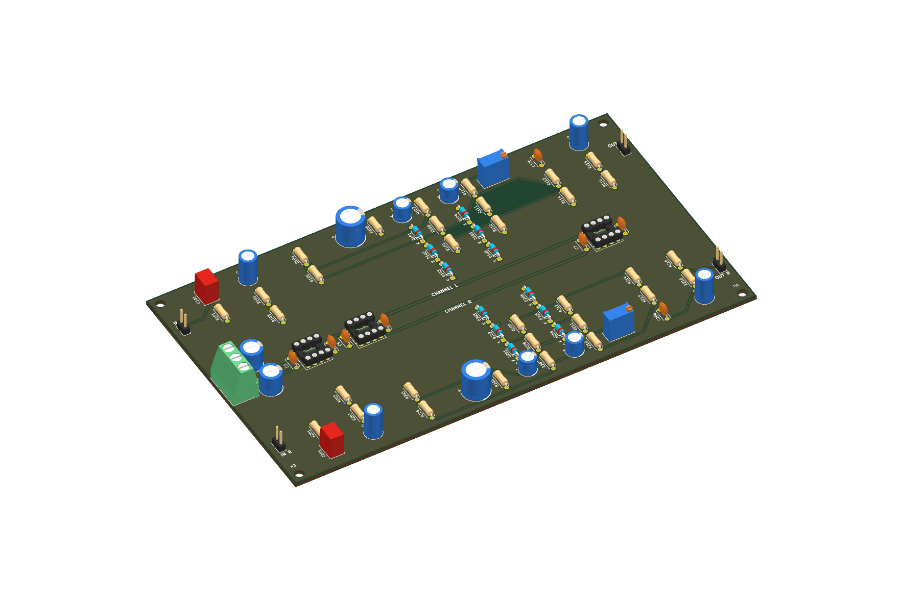

# Warm opamp preamp – tube character, designed by a genetic algorithm

A stereo hi-fi preamp built with opamps that imitates the warm distortion character
of a **12AX7 tube stage**. The component values were found by a **genetic
algorithm** that compared thousands of ngspice simulations against a simulated tube.
Includes the KiCad 10 schematic, two PCB designs (through-hole to solder yourself,
SMD to have it assembled by a PCB fab) and full documentation.

A project by **KyntoSoftware**.



| | |
|---|---|
| Gain | 10 dB |
| Frequency response | 20 Hz – 20 kHz ±0.11 dB |
| Distortion at 1 V rms | 0.31 % (almost only H2, the same as the 12AX7) |
| Signal-to-noise | approx. 97.5 dB re 1 V rms |
| Parts | 3× NE5532, 12× 1N4148, 1 % resistors, 2 trimmers |
| Power | ±15 V regulated |
| PCB | 2 layers; through-hole 178 × 100 mm or SMD 129 × 72 mm (assembled by a fab) |

**Status:** fully simulated and checked (NE5532 model, Monte Carlo tolerances,
ERC/DRC without errors). Not yet physically built and measured.

## Where to find what

| Folder / file | Content |
|---|---|
| [docs/](docs/README.md) | **documentation**: how it works, design process, results, build guide |
| `docs/img/`, `docs/data/` | charts and raw numbers (JSON/CSV) |
| `hardware/kicad/`, `hardware/export/` | through-hole: KiCad 10 project, Gerbers, schematic PDF/SVG, PCB layers, 3D renders, parts list |
| `hardware/kicad_smd/`, `hardware/export_smd/` | SMD version: same, plus assembly files for the fab ([explanation](docs/07_assembled_smd.md)) |
| `designs/` | design values per GA run and the final design (`final.json`) |
| `circuitbuilder/` | Python package: ngspice wrapper, analysis, candidate, fitness, as-built design |
| `scripts/` | every step: reference, GA, checks, schematic, PCB, documentation |

## Quick start

```powershell
python -m venv .venv
.\.venv\Scripts\pip install -r requirements.txt
.\.venv\Scripts\python scripts\verify_build.py      # simulate the as-built circuit
.\.venv\Scripts\python scripts\make_hardware.py     # KiCad schematic, PCB, Gerbers, renders
.\.venv\Scripts\python scripts\make_hardware.py --variant smd   # same for the SMD version
```

Requires ngspice 47 in `tools/Spice64`, KiCad 10, and Java + Freerouting 2.5 in
`tools/freerouting/`. See [docs/06_software.md](docs/06_software.md) for all steps.

## License

Copyright © 2026 KyntoSoftware. Each kind of work has the license that was made for it.
All three are permissive: you may use, modify, share and sell, also commercially, as
long as you credit KyntoSoftware.

| What | License | File |
|---|---|---|
| Software (`circuitbuilder/`, `scripts/`) | MIT | [LICENSE](LICENSE) |
| Hardware design (`hardware/`, `designs/`) | CERN-OHL-P v2 | [LICENSE-HARDWARE](LICENSE-HARDWARE) |
| Documentation, charts and images (`docs/`) | CC BY 4.0 | [LICENSE-DOCS](LICENSE-DOCS) |

Third-party simulation models keep their own terms: the NE5534 macromodel in
`circuitbuilder/models/ne5532.lib` (TI/MicroSim, via the
[KiCad-Spice-Library](https://github.com/kicad-spice-library/KiCad-Spice-Library)) and
the 12AX7 model in `circuitbuilder/models/12ax7.lib` (after Norman Koren).

The design is provided as is, without warranty; see the license files. Building it
involves a ±15 V supply; mains-powered supplies should only be built by people
experienced with mains voltage.
