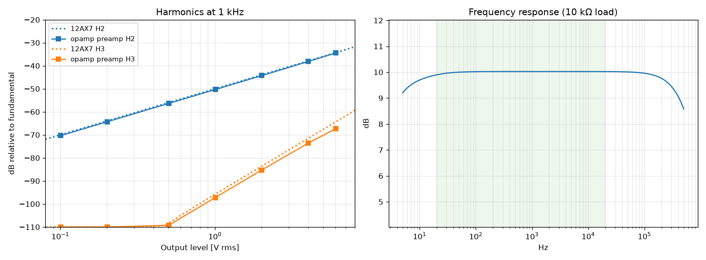

# Warm opamp preamp with 12AX7 character

*A hi-fi preamp with the distortion character of a tube stage, built with opamps.
The component values were not picked by hand: a genetic algorithm found them.*

A project by **KyntoSoftware**.

## At a glance

| | |
|---|---|
| **What** | Stereo line preamp, placed in front of an existing power amplifier |
| **Sound** | The subtly warm character of a 12AX7 tube stage: mostly second harmonic (H2), which grows with the level |
| **Gain** | 10 dB (×3.2) |
| **Frequency range** | 20 Hz – 20 kHz within ±0.11 dB |
| **Distortion at 1 V rms** | 0.3 %, almost only H2, the same as the tube (−50 dB) |
| **Signal-to-noise** | approx. 97.5 dB re 1 V rms (unweighted, 20 kHz bandwidth) |
| **Parts** | 3× NE5532, 12× 1N4148, 1 % resistors, 2 trimmers |
| **Power** | ±15 V regulated |
| **PCB** | Two variants, KiCad 10: through-hole to solder yourself (178 × 100 mm) and SMD to have it assembled by a PCB fab (129 × 72 mm) |

## The idea

Tube amplifiers are often called "warm". That is mostly down to how a triode
distorts: softly and asymmetrically, mostly as **second harmonic** (one octave above
the fundamental). At low levels the distortion is negligible; the louder it gets,
the more H2. The third harmonic (H3), which sounds harsher, stays much lower.

Opamps, on the other hand, are extremely linear. This project uses a few diodes to
add exactly that "tube distortion": **an even-harmonic generator** whose output is
added to the clean signal. How much of what, and with which resistor values, is a
puzzle with eleven interacting variables. A **genetic algorithm** solved that puzzle
by simulating thousands of variants in SPICE and comparing them with a simulated
12AX7 stage.

## The result in one picture

*Left: the second (blue) and third (orange) harmonic versus output level. Dotted
line = 12AX7 tube stage, line with squares = this opamp circuit (simulated with the
NE5532 model). Right: the frequency response.*

## Read on

1. [How the circuit works](02_how_it_works.md)
2. [The design process with a genetic algorithm](03_design_process.md)
3. [Results and checks](04_results.md)
4. [Build guide: parts, PCB, trimming](05_build_guide.md)
5. [Running the software yourself](06_software.md)
6. [Having it made ready-to-use: the SMD version](07_assembled_smd.md)

> **Status:** the design has been fully simulated and checked (NE5532 model,
> tolerances, ERC/DRC). It has not been physically built and measured yet.
