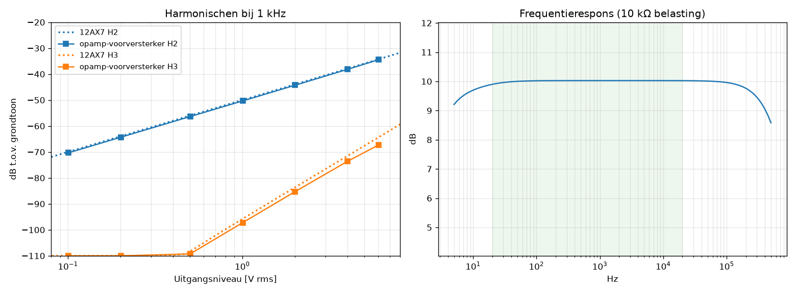

# Warme opamp-voorversterker met 12AX7-karakter

*Een hifi-voorversterker die klinkt als een buizentrap, maar gebouwd is met opamps.
De componentwaarden zijn niet met de hand gekozen: een genetisch algoritme heeft ze
gevonden.*

## In het kort

| | |
|---|---|
| **Wat** | Stereo lijnvoorversterker (voortrap) voor hifi, te plaatsen vóór een bestaande eindversterker |
| **Klank** | Het subtiel warme karakter van een 12AX7-buizentrap: vooral tweede harmonische (H2), die meegroeit met het niveau |
| **Versterking** | 10 dB (×3,2) |
| **Frequentiebereik** | 20 Hz – 20 kHz binnen ±0,11 dB |
| **Vervorming bij 1 V rms** | 0,3 %, vrijwel alleen H2, gelijk aan de buis (−50 dB) |
| **Signaal/ruis** | ca. 97,5 dB t.o.v. 1 V rms (ongewogen, 20 kHz bandbreedte) |
| **Onderdelen** | 3× NE5532P, 12× 1N4148, metaalfilmweerstanden 1 %, 2 trimpotten |
| **Voeding** | ±15 V gestabiliseerd |
| **Print** | Twee varianten, KiCad 10: through-hole om zelf te solderen (178 × 100 mm) en SMD om kant-en-klaar te laten monteren (129 × 72 mm) |

## Het idee

Buizenversterkers worden vaak "warm" genoemd. Dat komt vooral door hoe een triode
vervormt: zacht en asymmetrisch, met vooral de **tweede harmonische** (een octaaf
boven de grondtoon). Bij zacht spelen is de vervorming verwaarloosbaar; hoe harder,
hoe meer H2. De derde harmonische (H3), die scherper klinkt, blijft veel lager.

Opamps zijn juist extreem lineair. Dit project voegt met een paar diodes precies de
"buizenvervorming" toe: **een even-harmonischen-generator** die bij elkaar opgeteld
wordt met het schone signaal. Hoeveel van wat, en met welke weerstandswaarden, is
een puzzel met elf variabelen die op elkaar ingrijpen. Die puzzel heeft een
**genetisch algoritme** opgelost door duizenden varianten te simuleren in SPICE en
te vergelijken met een gesimuleerde 12AX7-trap.

## Resultaat in één beeld

*Links: de tweede (blauw) en derde (oranje) harmonische als functie van het
uitgangsniveau. Stippellijn = 12AX7-buizentrap, lijn met blokjes = deze
opamp-schakeling (gesimuleerd met het NE5532-model). Rechts: de frequentierespons.*

## Verder lezen

1. [Hoe de schakeling werkt](02_hoe_het_werkt.md)
2. [Het ontwerpproces met een genetisch algoritme](03_ontwerpproces.md)
3. [Resultaten en controles](04_resultaten.md)
4. [Bouwhandleiding: onderdelen, print, afregelen](05_bouwhandleiding.md)
5. [De software zelf draaien](06_software.md)
6. [Kant-en-klaar laten maken: de SMD-versie](07_kant_en_klaar_smd.md)

> **Status:** ontwerp volledig gesimuleerd en gecontroleerd (NE5532-model,
> toleranties, ERC/DRC). Nog niet fysiek gebouwd en gemeten.
