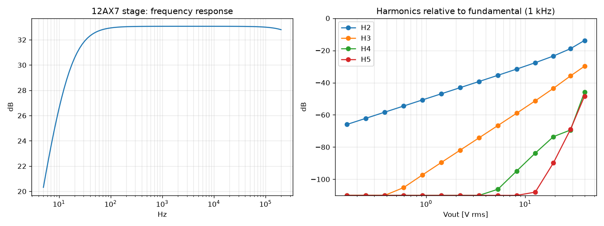
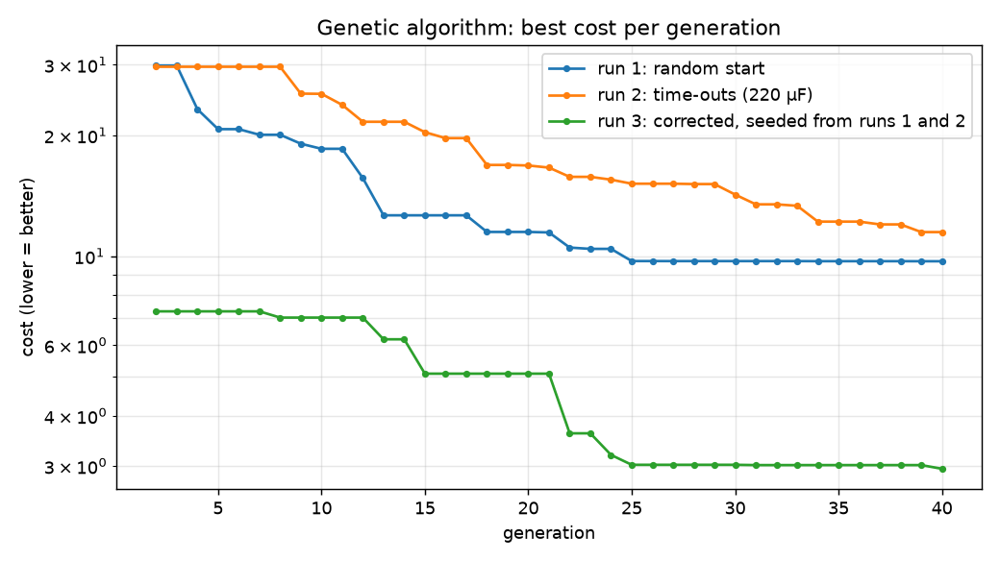

# The design process: a genetic algorithm as designer

## 1. Defining the target: a simulated 12AX7

The reference is a classic common-cathode 12AX7 stage (B+ 250 V, Ra 100 kΩ,
Rk 1.5 kΩ bypassed), simulated in ngspice with Norman Koren's well-known tube model.
Operating point: 170 V on the plate, 0.8 mA.

The tube's "fingerprint":

- at 1 V rms output: **H2 ≈ −50 dB (0.3 %)**, H3 ≈ −96 dB;
- H2 rises **6 dB** per doubling of the level, H3 **12 dB**;
- H4 and above stay far below −90 dB up to high levels.

Those curves (H2…H5 versus output level) are the target. The data is in
`docs/data/tube_12ax7_harmonics.json`.

## 2. A candidate circuit with free knobs

The topology (see [how it works](02_how_it_works.md)) is fixed; the algorithm picks
**eleven values**: ten resistors from the E24 series (100 Ω – 1 MΩ) and the number of
diodes per branch (1 – 4). That is roughly 10¹⁸ combinations: far too many to try.

## 3. Scoring each candidate (fitness)

For each candidate, ngspice runs a transient simulation at six levels (0.1 – 7 V rms
output, 1 kHz sine), an AC analysis and a noise analysis. The "cost" (lower = better)
is the sum of:

| Term | What is measured |
|---|---|
| gain | deviation from 10 dB |
| H2 | RMS difference in dB from the tube over all levels |
| H3 | same, with a lower weight |
| H4/H5 | penalty if higher than the tube (below −90 dB does not count) |
| flatness | penalty if the 20 Hz – 20 kHz response deviates by more than ±0.2 dB |
| noise | penalty if the signal-to-noise ratio falls below 100 dB (re 1 V rms) |

Designs whose gain is far from 10 dB are rejected by a quick AC check, without the
expensive transient simulation.

## 4. Evolution

- Population of 48 designs, 40 generations, pymoo GA with SBX crossover and
  polynomial mutation on integers (index into the E24 series).
- 8 ngspice processes in parallel; one evaluation takes 3 – 5 s.
- After the GA a **local search step**: try the neighbours in the E24 series for
  each value.

| Run | What happened | Cost |
|---|---|---|
| 1 | Random start. The GA switched off branch B: a single diode chain already behaved tube-like. H2 stayed 5 dB too low. | 9.7 |
| 2 | Noise target relaxed, symmetric starting designs. Failed: a larger coupling capacitor made the simulation 4× slower, and good designs ran into the time-out. | 11.2 |
| 3 | Corrected, seeded from runs 1 and 2. **Both branches active**, H2 and H3 within ~1 dB of the tube. | **2.9** |

Run 3 shows why the second branch is useful: with two nearly symmetric branches the
algorithm can set H2 and H3 independently.

## 5. From GA result to a buildable design

- **Gain exactly 10 dB:** RF2 (R114) changed from 1k2 to **1k27** (E96). This also
  compensates for the 0.1 dB loss in the output resistor. RF2 scales the clean and the
  distorted path equally, so the character stays the same.
- **Trimmer:** RB = 4k42 fixed + 500 Ω trimmer (nominal 4k7). Chosen based on a
  sensitivity analysis: RB mainly affects H3 (−0.5 dB per 1 %).
- **Practical additions:** supply filter for the diodes, output network
  (100 Ω, 10 µF bipolar, 100 kΩ), decoupling, stereo on one board.
- The whole circuit was simulated again with the **NE5532 macromodel** (see
  [results](04_results.md)).

Design values per run: `docs/data/design_run1.json` … `design_run3.json`,
final: `docs/data/final_design.json`.
