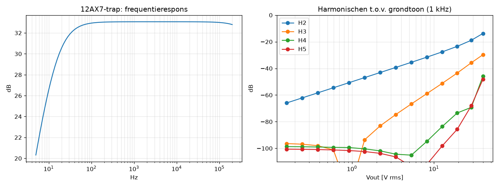
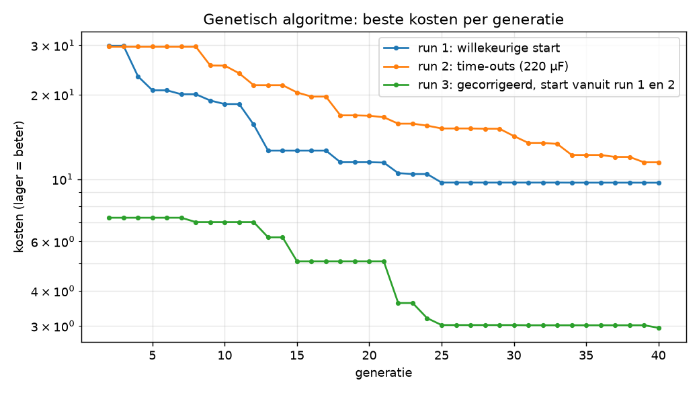

# Het ontwerpproces: een genetisch algoritme als ontwerper

## 1. Het doel vastleggen: een gesimuleerde 12AX7

Als referentie dient een klassieke 12AX7-trap met gemeenschappelijke kathode
(B+ 250 V, Ra 100 kΩ, Rk 1,5 kΩ ontkoppeld), gesimuleerd in ngspice met het bekende
buismodel van Norman Koren. Werkpunt: 170 V op de plaat, 0,8 mA.

Het "vingerafdruk" van de buis:

- bij 1 V rms uitgang: **H2 ≈ −50 dB (0,3 %)**, H3 ≈ −96 dB;
- H2 stijgt **6 dB** per verdubbeling van het niveau, H3 **12 dB**;
- H4 en hoger blijven ver onder −90 dB tot hoge niveaus.

Die curves (H2…H5 als functie van het uitgangsniveau) zijn het doel. De data staat in
`docs/data/tube_12ax7_harmonics.json`.

## 2. Een kandidaat-schakeling met vrije knoppen

De topologie (zie [hoe het werkt](02_hoe_het_werkt.md)) ligt vast; het algoritme kiest
**elf waarden**: tien weerstanden uit de E24-reeks (100 Ω – 1 MΩ) en het aantal
diodes per tak (1 – 4). Dat zijn ongeveer 10¹⁸ combinaties: te veel om uit te proberen.

## 3. Elke kandidaat beoordelen (fitness)

Per kandidaat draait ngspice een transiëntsimulatie bij zes niveaus (0,1 – 7 V rms
uitgang, sinus 1 kHz), een AC-analyse en een ruisanalyse. De "kosten" (lager = beter)
tellen op uit:

| Onderdeel | Wat wordt gemeten |
|---|---|
| versterking | afwijking van 10 dB |
| H2 | RMS-verschil in dB met de buis over alle niveaus |
| H3 | idem, met lager gewicht |
| H4/H5 | straf als hoger dan de buis (onder −90 dB telt niet) |
| vlakheid | straf als de frequentierespons 20 Hz – 20 kHz meer dan ±0,2 dB afwijkt |
| ruis | straf als signaal/ruis onder 100 dB (t.o.v. 1 V rms) komt |

Ontwerpen met een versterking ver naast 10 dB worden met een snelle AC-check al
afgewezen, zonder dure transiëntsimulatie.

## 4. Evolutie

- Populatie van 48 ontwerpen, 40 generaties, pymoo-GA met SBX-kruising en
  polynomiale mutatie op gehele getallen (index in de E24-reeks).
- 8 ngspice-processen parallel; één evaluatie kost 3 – 5 s.
- Na het GA een **lokale zoekstap**: per waarde de buren in de E24-reeks proberen.

| Run | Wat er gebeurde | Kosten |
|---|---|---|
| 1 | Willekeurige start. Het GA schakelde tak B uit: één diodeketen bleek al buis-achtig. H2 bleef 5 dB te laag. | 9,7 |
| 2 | Ruisdoel versoepeld, symmetrische startontwerpen. Mislukt: een grotere koppelcondensator maakte de simulatie 4× trager, goede ontwerpen liepen in de time-out. | 11,2 |
| 3 | Gecorrigeerd, gestart vanuit run 1 en 2. **Beide takken actief**, H2 en H3 binnen ~1 dB van de buis. | **2,9** |

Run 3 laat zien waarom de tweede tak zinvol is: met twee bijna-symmetrische takken kan
het algoritme H2 en H3 onafhankelijk instellen.

## 5. Van GA-resultaat naar bouwbaar ontwerp

- **Versterking exact 10 dB:** RF2 (R114) van 1k2 naar **1k27** (E96). Dat compenseert
  ook het verlies van 0,1 dB in de uitgangsweerstand. RF2 schaalt het schone en het
  vervormde pad gelijk op, dus het karakter blijft gelijk.
- **Trimpot:** RB = 4k42 vast + 500 Ω trimpot (nominaal 4k7). Gekozen op basis van een
  gevoeligheidsanalyse: RB beïnvloedt vooral H3 (−0,5 dB per 1 %).
- **Praktische toevoegingen:** voedingsfilter voor de diodes, uitgangsnetwerk
  (100 Ω, 10 µF bipolair, 100 kΩ), ontkoppeling, stereo op één print.
- Het geheel is opnieuw gesimuleerd met het **NE5532-macromodel** (zie
  [resultaten](04_resultaten.md)).

Ontwerpwaarden per run: `docs/data/design_run1.json` … `design_run3.json`,
definitief: `docs/data/final_design.json`.
