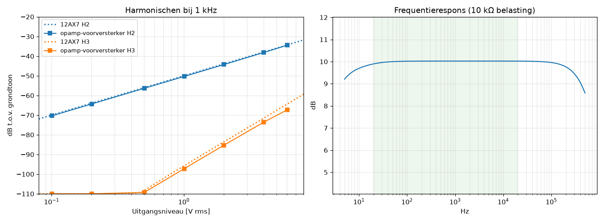
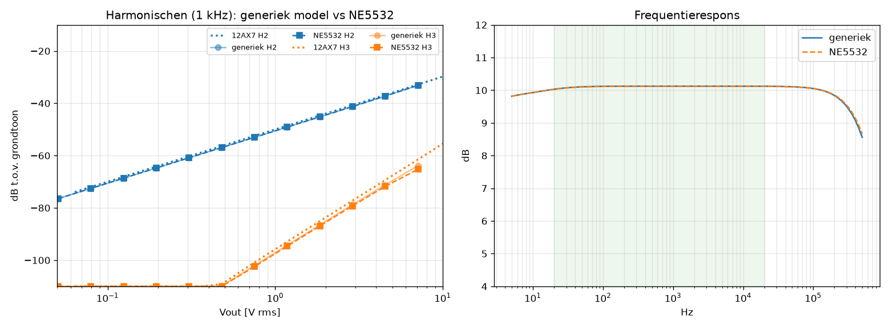
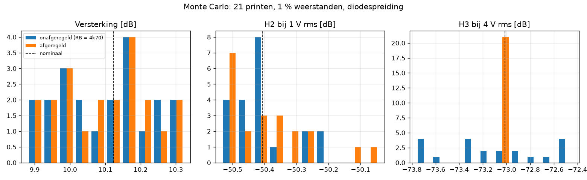

# Resultaten en controles

Alle resultaten zijn **simulaties** in ngspice van de schakeling zoals hij op de print
staat (inclusief voedingsfilter, uitgangsnetwerk en 10 kΩ belasting), met het
NE5532-macromodel. Er is nog geen fysiek exemplaar gemeten.

## Kerncijfers

| Grootheid | Waarde |
|---|---|
| Versterking (1 kHz) | **10,03 dB** |
| Frequentierespons 20 Hz – 20 kHz | **±0,11 dB** |
| Vervorming bij 1 V rms | **0,31 %** (H2 −50,3 dB; buis −50,0 dB) |
| H3 bij 1 V rms | −97 dB (buis −96 dB) |
| H4, H5 | onder −99 dB tot 6 V rms |
| Signaal/ruis | **97,5 dB** t.o.v. 1 V rms (ongewogen, 20 Hz – 20 kHz) |
| Brom­onderdrukking +15 V | 41,6 dB bij 100 Hz, 61,5 dB bij 1 kHz |
| Maximaal uitgangsniveau | ca. 7 V rms (10 kΩ belasting) |
| Ingangsimpedantie | 100 kΩ |
| Werkpunt | VP 14,86 V · diodeketens 1,77 / 1,78 V · DC op uitgang 0 V |

Cijfers als data: `docs/data/key_figures.json` en `docs/data/verify_build.json`.

## Harmonischen: opamp tegenover buis

| Uitgang (V rms) | THD | H2 opamp | H2 buis | H3 opamp | H3 buis |
|---|---|---|---|---|---|
| 0,1 | 0,03 % | −70,3 dB | −70,0 dB | < −110 dB | < −110 dB |
| 0,2 | 0,06 % | −64,3 dB | −63,9 dB | < −110 dB | < −110 dB |
| 0,5 | 0,15 % | −56,4 dB | −56,0 dB | −109 dB | −108 dB |
| 1,0 | 0,31 % | −50,3 dB | −50,0 dB | −97,2 dB | −95,8 dB |
| 2,0 | 0,61 % | −44,3 dB | −43,9 dB | −85,3 dB | −83,6 dB |
| 4,0 | 1,24 % | −38,1 dB | −37,9 dB | −73,6 dB | −71,5 dB |
| 6,0 | 1,89 % | −34,5 dB | −34,3 dB | −67,3 dB | −64,4 dB |

H2 volgt de buis binnen 0,4 dB over het hele bereik. H3 ligt 1 – 3 dB onder de buis,
met dezelfde helling (12 dB per verdubbeling). Met de trimpot kan H3 desgewenst
±3 dB worden bijgesteld.

## Controle met de echte NE5532

Het genetisch algoritme rekende met een snel, generiek opamp-model. Ter controle is
het ontwerp ook doorgerekend met het TI-macromodel van de NE5532: versterking,
vlakheid en harmonischen komen tot op 0,1 dB overeen. Alleen de ruis is ca. 1,5 dB
hoger, omdat het model iets meer ruist (6,4 nV/√Hz) dan de datasheet opgeeft
(5 nV/√Hz). In de praktijk valt de ruis dus eerder iets beter uit.

## Toleranties

Hoe nauwkeurig is een zelfgebouwd exemplaar? Een Monte-Carlo-analyse simuleerde
virtuele printen met willekeurige afwijkingen: weerstanden ±1 % (uniform) en spreiding
tussen de diodes (verzadigingsstroom lognormaal, σ = 0,25, ca. ±11 mV drempel).
21 van de 24 virtuele printen leverden een bruikbare simulatie op (3 liepen in de
tijdslimiet van de simulator).

| Grootheid | Spreiding zonder afregelen (σ) | Met afregelen (σ) |
|---|---|---|
| Versterking | ±0,13 dB | ±0,12 dB |
| H2 bij 1 V rms | ±0,09 dB | ±0,13 dB |
| H3 bij 4 V rms | ±0,43 dB | ±0,01 dB |

Conclusie: **de schakeling is robuust**. Ook zonder meetapparatuur zit een exemplaar
met 1 %-weerstanden binnen een halve dB van het ontwerp. De benodigde trimpotstand
lag in alle gevallen tussen 4632 en 4758 Ω, ruim binnen het bereik (4420 – 4920 Ω).

Waarom zo robuust? Bij een vaste instelstroom hangt de vorm van de diodekromme niet af
van de verzadigingsstroom van de diode; spreiding tussen diodes verschuift alleen de
gelijkspanning. De gevoeligheidsanalyse (`docs/data/sensitivity.json`) bevestigt dat:
1 % afwijking in een willekeurige weerstand verschuift H2 hooguit 0,1 dB en H3 hooguit
0,5 dB.

## Beperkingen

- De voedingsonderdrukking van de opamps zelf (ca. 100 dB volgens de datasheet) zit
  niet in het macromodel; alleen het pad via de diodevoorspanning is gesimuleerd.
  Gebruik daarom een gestabiliseerde voeding.
- Dynamische buiseffecten (voedingsdip/"sag", biasverschuiving bij overbelasting) worden
  niet nagebootst; het ontwerp richt zich op de statische harmonische vingerafdruk.
- De referentie is één generieke 12AX7-trap. Een echte buizenvoorversterker heeft vaak
  meerdere trappen en een uitgangstrafo.
