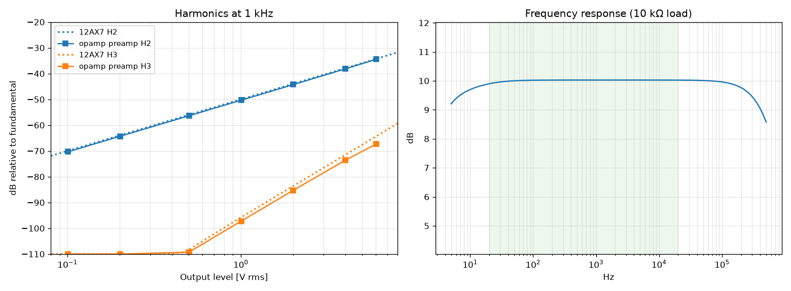
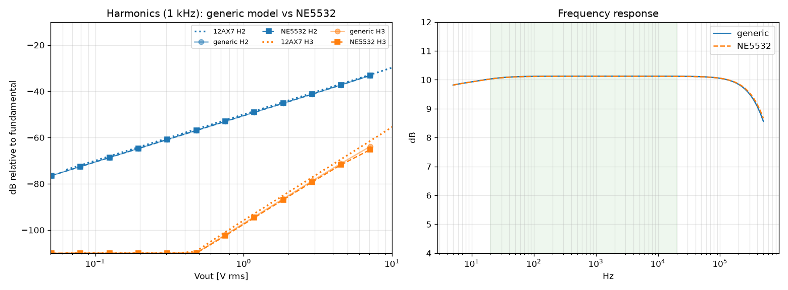
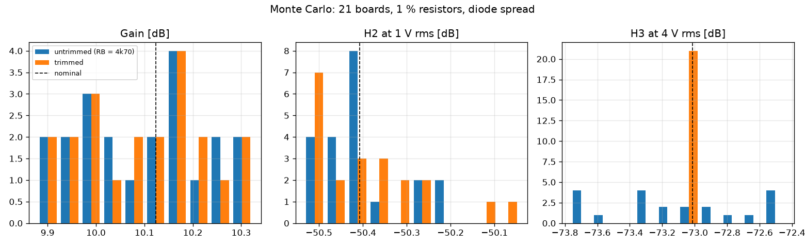

# Results and checks

All results are ngspice **simulations** of the circuit as it is on the PCB (including
the supply filter, output network and a 10 kΩ load), using the NE5532 macromodel.
No physical unit has been measured yet.

## Key figures

| Quantity | Value |
|---|---|
| Gain (1 kHz) | **10.03 dB** |
| Frequency response 20 Hz – 20 kHz | **±0.11 dB** |
| Distortion at 1 V rms | **0.31 %** (H2 −50.3 dB; tube −50.0 dB) |
| H3 at 1 V rms | −97 dB (tube −96 dB) |
| H4, H5 | below −99 dB up to 6 V rms |
| Signal-to-noise | **97.5 dB** re 1 V rms (unweighted, 20 Hz – 20 kHz) |
| Hum rejection +15 V | 41.6 dB at 100 Hz, 61.5 dB at 1 kHz |
| Maximum output level | approx. 7 V rms (10 kΩ load) |
| Input impedance | 100 kΩ |
| Operating point | VP 14.86 V · diode chains 1.77 / 1.78 V · DC at output 0 V |

Figures as data: `docs/data/key_figures.json` and `docs/data/verify_build.json`.

## Harmonics: opamp versus tube

| Output (V rms) | THD | H2 opamp | H2 tube | H3 opamp | H3 tube |
|---|---|---|---|---|---|
| 0.1 | 0.03 % | −70.3 dB | −70.0 dB | < −110 dB | < −110 dB |
| 0.2 | 0.06 % | −64.3 dB | −63.9 dB | < −110 dB | < −110 dB |
| 0.5 | 0.15 % | −56.4 dB | −56.0 dB | −109 dB | −108 dB |
| 1.0 | 0.31 % | −50.3 dB | −50.0 dB | −97.2 dB | −95.8 dB |
| 2.0 | 0.61 % | −44.3 dB | −43.9 dB | −85.3 dB | −83.6 dB |
| 4.0 | 1.24 % | −38.1 dB | −37.9 dB | −73.6 dB | −71.5 dB |
| 6.0 | 1.89 % | −34.5 dB | −34.3 dB | −67.3 dB | −64.4 dB |

H2 tracks the tube within 0.4 dB over the whole range. H3 is 1 – 3 dB below the tube,
with the same slope (12 dB per doubling). The trimmer can shift H3 by ±3 dB if
desired.

## Check with the real NE5532

The genetic algorithm used a fast, generic opamp model. As a check, the design was
also simulated with TI's NE5532 macromodel: gain, flatness and harmonics agree to
within 0.1 dB. Only the noise is about 1.5 dB higher, because the model is a bit
noisier (6.4 nV/√Hz) than the datasheet states (5 nV/√Hz). In practice the noise is
therefore likely to turn out slightly better.

## Tolerances

How accurate will a home-built unit be? A Monte Carlo analysis simulated virtual
boards with random deviations: resistors ±1 % (uniform) and spread between the diodes
(saturation current lognormal, σ = 0.25, approx. ±11 mV threshold). 21 of the 24
virtual boards produced a usable simulation (3 hit the simulator's time limit).

| Quantity | Spread untrimmed (σ) | Trimmed (σ) |
|---|---|---|
| Gain | ±0.13 dB | ±0.12 dB |
| H2 at 1 V rms | ±0.09 dB | ±0.13 dB |
| H3 at 4 V rms | ±0.43 dB | ±0.01 dB |

Conclusion: **the circuit is robust**. Even without measuring equipment, a unit with
1 % resistors lands within half a dB of the design. The required trimmer setting was
between 4632 and 4758 Ω in every case, well within the range (4420 – 4920 Ω).

Why so robust? At a fixed bias current, the shape of the diode curve does not depend
on the diode's saturation current; spread between diodes only shifts the DC voltage.
The sensitivity analysis (`docs/data/sensitivity.json`) confirms this: a 1 % deviation
in any resistor shifts H2 by at most 0.1 dB and H3 by at most 0.5 dB.

## Limitations

- The opamps' own power-supply rejection (approx. 100 dB according to the datasheet)
  is not in the macromodel; only the path through the diode bias is simulated. Use a
  regulated supply for that reason.
- Dynamic tube effects (supply sag, bias shift under overload) are not imitated; the
  design targets the static harmonic fingerprint.
- The reference is one generic 12AX7 stage. A real tube preamp often has several
  stages and an output transformer.
