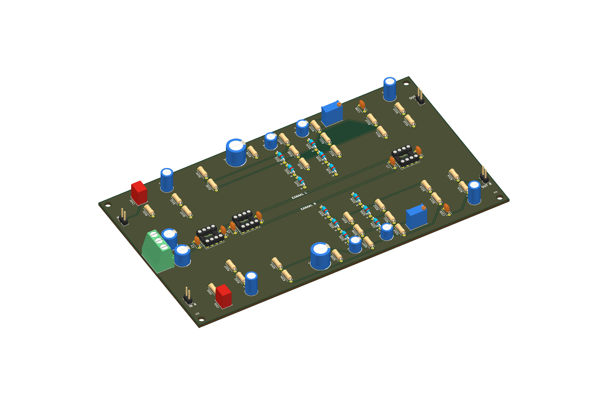

# Bouwhandleiding

> Deze handleiding is voor de **through-hole-versie**, om zelf te solderen. Kun of
> wil je niet solderen? Laat dan de [SMD-versie kant-en-klaar maken](07_kant_en_klaar_smd.md).

## Wat je nodig hebt

- De print (Gerbers: `hardware/export/warm_preamp_gerbers.zip`, te bestellen bij elke
  printfabrikant, bijv. JLCPCB, PCBWay of Aisler). Specificaties: 2 lagen, 1,6 mm FR4,
  178 × 100 mm, 1 oz koper, alle gaten doorgemetalliseerd.
- De onderdelen uit de [onderdelenlijst](#onderdelenlijst).
- Een **gestabiliseerde ±15 V-voeding** van minimaal 100 mA per rail, met weinig rimpel
  (< 5 mV), bijv. een LM317/LM337- of 7815/7915-module.
- Afgeschermde kabel en cinch-(RCA-)bussen in de behuizing; de print heeft
  pinheaders voor in- en uitgangen.
- Optioneel voor afregelen: een geluidskaart en het gratis programma REW (Room EQ
  Wizard).

## Onderdelenlijst

De volledige lijst met referenties staat in `hardware/export/bom.csv` (en
`docs/data/bom.json`). Samengevat voor de hele stereoprint:

| Aantal | Waarde | Onderdeel |
|---|---|---|
| 3 | NE5532P | Dubbele low-noise opamp, DIP-8, plus 3 IC-voeten |
| 12 | 1N4148 | Kleinsignaaldiode (DO-35) |
| 2 | 500R | Trimpot meerslagen, Bourns 3296W (staand) |
| 32 | zie hieronder | Metaalfilmweerstanden 1 %, 0,25 W |
| 2 | 2µ2 | Foliecondensator (MKS2/MKP), rastermaat 5 mm |
| 2 | 22p | Keramisch C0G/NP0 |
| 6 | 100n | Keramisch (ontkoppeling) |
| 4 | 47µ 25V | Elco, ø 6,3 mm |
| 2 | 470µ 25V | Elco, ø 10 mm |
| 2 | 100µ 25V | Elco, ø 8 mm |
| 4 | 22µ / 10µ | Bipolaire elco (NP), ø 6,3 mm |
| 1 | | Schroefklem 3-polig, 5,08 mm |
| 4 | | Pinheader 1×2, 2,54 mm |

Weerstanden (metaalfilm 1 %, 0,25 W), per stereoprint:

| Aantal | Waarde | Referenties |
|---|---|---|
| 2 | 47R | R106 R206 |
| 2 | 100R | R115 R215 |
| 2 | 160R | R112 R212 |
| 2 | 180R | R109 R209 |
| 2 | 1k2 | R113 R213 |
| 2 | 1k27 | R114 R214 |
| 2 | 4k42 | R110 R210 |
| 2 | 6k2 | R107 R207 |
| 2 | 8k2 | R111 R211 |
| 2 | 9k1 | R108 R208 |
| 4 | 10k | R104 R105 R204 R205 |
| 2 | 20k | R103 R203 |
| 2 | 39k | R102 R202 |
| 4 | 100k | R101 R116 R201 R216 |

> Let op de E96-waarden **1k27** (R114/R214) en **4k42** (R110/R210): gewone
> metaalfilmweerstanden 1 %, verkrijgbaar bij elke grote leverancier.

## Solderen: volgorde

1. Weerstanden en diodes (let op de **richting van de diodes**: de streep = kathode,
   zoals aangegeven op de print).
2. IC-voeten (inkeping naar rechts, zoals op de print; pin 1 rechtsboven).
3. Keramische en foliecondensatoren.
4. Trimpotten – **eerst instellen, zie hieronder**.
5. Elco's (let op de **polariteit**: + is het vierkante eiland; bipolaire elco's
   mogen beide kanten op).
6. Schroefklem en pinheaders.
7. Opamps pas plaatsen na de eerste spanningscontrole.

## Eerste keer aanzetten

1. **Zonder opamps** de voeding aansluiten. Controleer: +15 V en −15 V op de voeten
   (pin 8 = +15 V, pin 4 = −15 V). Spanning op knooppunt VP (plus van C103/C203):
   ca. 14,9 V. Spanning over elke diodeketen: ca. 1,8 V.
2. Voeding uit, opamps plaatsen (inkeping naar rechts, pin 1 rechtsboven).
3. Voeding aan. Stroomopname: ca. 30 mA (+15 V) en 25 mA (−15 V).
4. Gelijkspanning op de uitgangen J4/J5: vrijwel 0 V (door de uitgangscondensator).
   Op de opamp-uitgangen (pin 1 en 7): binnen ±50 mV.

## Afregelen

De trimpot RV101/RV201 regelt de balans tussen de twee diodetakken, en daarmee de
hoeveelheid derde harmonische (H3). De tolerantieanalyse (zie
[resultaten](04_resultaten.md#toleranties)) laat zien dat de schakeling ook zonder
meten al heel dicht bij het ontwerp zit.

**Methode 1 – zonder meetapparatuur (aanbevolen):** stel vóór het solderen met een
multimeter de weerstand tussen pin 1 en de loper (pin 2) van elke trimpot in op
**280 Ω**. Samen met de vaste 4k42 geeft dat precies de ontwerpwaarde 4k70.

**Methode 2 – met geluidskaart en REW:**

1. Stuur een sinus van 1 kHz in, zo sterk dat de uitgang **4 V rms** geeft.
2. Meet de uitgang via een spanningsdeler 10:1 (bijv. 10 kΩ / 1,1 kΩ) met REW
   (venster *RTA* of *Distortion*).
3. Draai aan de trimpot tot **H3 ≈ −73,5 dB** t.o.v. de grondtoon (H2 hoort dan op
   ca. −38 dB te liggen). Meer weerstand = minder H3.

**Smaakknop:** wie het karakter iets wil bijsturen, kan met de trimpot H3 ongeveer
±3 dB verschuiven zonder dat H2 of de versterking merkbaar verandert.

## Aansluiten

- **Voeding:** schroefklem J1: +15 V, GND, −15 V (opgedrukt op de print).
- **Ingangen** J2 (L) en J3 (R), **uitgangen** J4 (L) en J5 (R): pin 1 = signaal,
  pin 2 = massa. Gebruik afgeschermde kabel; verbind de afscherming aan de printkant.
- De voortrap verwacht een lijnbron (cd, DAC, streamer: tot ca. 2 V rms) en kan een
  eindversterker met ≥ 10 kΩ ingangsimpedantie aansturen tot ca. 7 V rms.
- Er zit geen volumeregeling op de print; plaats die eventueel vóór de ingang
  (bijv. een logaritmische potmeter van 10 kΩ).

## Printontwerp

- KiCad 10-project: `hardware/kicad/warm_preamp.kicad_pro` (schema, print,
  bibliotheektabellen).
- Indeling: drie IC's op de middenlijn, kanaal L boven, kanaal R gespiegeld onder,
  signaal van links (ingang) naar rechts (uitgang); voeding links in het midden.
- Massavlak op beide lagen, voedingssporen 0,8 mm, signaalsporen 0,4 mm.
- Automatisch gerouteerd met Freerouting; controles: ERC en DRC (zie
  `hardware/kicad/erc.rpt` en `drc.rpt`).
