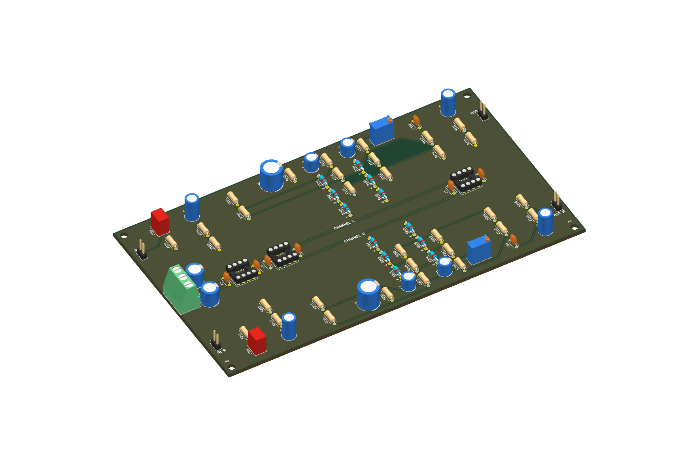

# Build guide

> This guide is for the **through-hole version**, which you solder yourself. Can't or
> don't want to solder? Then have the [SMD version made ready-to-use](07_assembled_smd.md).

## What you need

- The PCB (Gerbers: `hardware/export/warm_preamp_gerbers.zip`, can be ordered from any
  PCB fab, e.g. JLCPCB, PCBWay or Aisler). Specification: 2 layers, 1.6 mm FR4,
  178 × 100 mm, 1 oz copper, all holes plated.
- The parts from the [parts list](#parts-list).
- A **regulated ±15 V supply** of at least 100 mA per rail, with little ripple
  (< 5 mV), e.g. an LM317/LM337 or 7815/7915 module.
- Shielded cable and RCA sockets in the enclosure; the PCB has pin headers for the
  inputs and outputs.
- Optional, for trimming: a sound card and the free program REW (Room EQ Wizard).

## Parts list

The full list with references is in `hardware/export/bom.csv` (and
`docs/data/bom.json`). Summary for the complete stereo board:

| Qty | Value | Part |
|---|---|---|
| 3 | NE5532P | Dual low-noise opamp, DIP-8, plus 3 IC sockets |
| 12 | 1N4148 | Small-signal diode (DO-35) |
| 2 | 500R | Multi-turn trimmer, Bourns 3296W (vertical) |
| 32 | see below | Metal film resistors 1 %, 0.25 W |
| 2 | 2µ2 | Film capacitor (MKS2/MKP), 5 mm pitch |
| 2 | 22p | Ceramic C0G/NP0 |
| 6 | 100n | Ceramic (decoupling) |
| 4 | 47µ 25V | Electrolytic, ø 6.3 mm |
| 2 | 470µ 25V | Electrolytic, ø 10 mm |
| 2 | 100µ 25V | Electrolytic, ø 8 mm |
| 4 | 22µ / 10µ | Bipolar electrolytic (NP), ø 6.3 mm |
| 1 | | Screw terminal 3-pin, 5.08 mm |
| 4 | | Pin header 1×2, 2.54 mm |

Resistors (metal film 1 %, 0.25 W), per stereo board:

| Qty | Value | References |
|---|---|---|
| 2 | 47R | R106 R206 |
| 2 | 100R | R115 R215 |
| 2 | 160R | R112 R212 |
| 2 | 180R | R109 R209 |
| 2 | 1k2 | R113 R213 |
| 2 | 1k27 | R114 R214 |
| 2 | 4k42 | R110 R210 |
| 2 | 6k2 | R107 R207 |
| 2 | 8k2 | R111 R211 |
| 2 | 9k1 | R108 R208 |
| 4 | 10k | R104 R105 R204 R205 |
| 2 | 20k | R103 R203 |
| 2 | 39k | R102 R202 |
| 4 | 100k | R101 R116 R201 R216 |

> Note the E96 values **1k27** (R114/R214) and **4k42** (R110/R210): ordinary 1 %
> metal film resistors, available from any major distributor.

## Soldering order

1. Resistors and diodes (mind the **diode orientation**: the band = cathode, as
   marked on the PCB).
2. IC sockets (notch to the right, as on the PCB; pin 1 top right).
3. Ceramic and film capacitors.
4. Trimmers – **set them first, see below**.
5. Electrolytics (mind the **polarity**: + is the square pad; bipolar electrolytics
   can go either way).
6. Screw terminal and pin headers.
7. Only insert the opamps after the first voltage check.

## First power-up

1. Connect the supply **without the opamps**. Check: +15 V and −15 V on the sockets
   (pin 8 = +15 V, pin 4 = −15 V). Voltage at node VP (positive side of C103/C203):
   approx. 14.9 V. Voltage across each diode chain: approx. 1.8 V.
2. Power off, insert the opamps (notch to the right, pin 1 top right).
3. Power on. Current draw: approx. 30 mA (+15 V) and 25 mA (−15 V).
4. DC voltage at the outputs J4/J5: practically 0 V (thanks to the output capacitor).
   At the opamp outputs (pins 1 and 7): within ±50 mV.

## Trimming

The trimmer RV101/RV201 sets the balance between the two diode branches, and with
that the amount of third harmonic (H3). The tolerance analysis (see
[results](04_results.md#tolerances)) shows that the circuit is already very close to
the design without any measuring.

**Method 1 – without measuring equipment (recommended):** before soldering, use a
multimeter to set the resistance between pin 1 and the wiper (pin 2) of each trimmer
to **280 Ω**. Together with the fixed 4k42 that gives exactly the design value 4k70.

**Method 2 – with a sound card and REW:**

1. Feed in a 1 kHz sine, strong enough for the output to reach **4 V rms**.
2. Measure the output through a 10:1 voltage divider (e.g. 10 kΩ / 1.1 kΩ) with REW
   (*RTA* or *Distortion* window).
3. Turn the trimmer until **H3 ≈ −73.5 dB** relative to the fundamental (H2 should
   then be at about −38 dB). More resistance = less H3.

**Flavour knob:** if you want to fine-tune the character, the trimmer can shift H3 by
about ±3 dB without noticeably changing H2 or the gain.

## Connecting

- **Power:** screw terminal J1: +15 V, GND, −15 V (printed on the PCB).
- **Inputs** J2 (L) and J3 (R), **outputs** J4 (L) and J5 (R): pin 1 = signal,
  pin 2 = ground. Use shielded cable; connect the shield at the PCB end.
- The preamp expects a line source (CD, DAC, streamer: up to approx. 2 V rms) and can
  drive a power amplifier with ≥ 10 kΩ input impedance up to approx. 7 V rms.
- There is no volume control on the board; if needed, put one before the input
  (e.g. a 10 kΩ logarithmic potentiometer).

## PCB design

- KiCad 10 project: `hardware/kicad/warm_preamp.kicad_pro` (schematic, PCB, library
  tables).
- Layout: three ICs on the centre line, channel L on top, channel R mirrored below,
  signal from left (input) to right (output); power on the left in the middle.
- Ground pour on both layers, power tracks 0.8 mm, signal tracks 0.4 mm.
- Autorouted with Freerouting; checks: ERC and DRC (see `hardware/kicad/erc.rpt` and
  `drc.rpt`).
