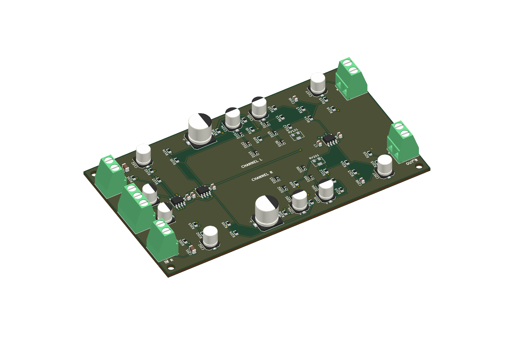

# Having it made ready-to-use (SMD version)

Not everyone can or wants to solder. That is why, next to the through-hole board,
there is an **SMD version**. It is designed to be **made and assembled** in one go by
a PCB fab: you receive a board with all parts already on it. No soldering left to do.
Power, inputs and outputs are connected with **screw terminals**.

The circuit and all component values are exactly the same as in the through-hole
version. Only the part packages are smaller.

> **Status:** like the through-hole version, the SMD board has been simulated and
> checked (ERC/DRC without errors), but it has **never been ordered, made or
> measured**. The price indication below is an estimate and has not been verified.

| | Through-hole | SMD |
|---|---|---|
| Intended for | soldering yourself | assembly by the PCB fab |
| PCB | 178 × 100 mm | 129 × 72 mm |
| Opamps | 3× NE5532P (DIP-8, in socket) | 3× NE5532DR (SOIC-8) |
| Diodes | 1N4148 (DO-35) | 1N4148WS (SOD-323) |
| Resistors | metal film 1 %, 0.25 W | thick film 1 %, 0805 |
| Input capacitor | 2µ2 film | 2µ2 ceramic X7R 50 V, 1206 |
| Trimmer | Bourns 3296W | Bourns 3224W (SMD) |
| Inputs and outputs | pin headers | screw terminals |
| Files | `hardware/kicad/`, `hardware/export/` | `hardware/kicad_smd/`, `hardware/export_smd/` |

## Do the different parts change the sound?

No, not measurably in the simulation, and not according to the physics either:

- **1N4148WS** is the same silicon diode as the 1N4148, just in a smaller package.
  Spread between diodes is already covered by the
  [tolerance analysis](04_results.md#tolerances).
- **NE5532DR** is the same IC as the NE5532P, in an SMD package.
- **Thick film resistors** produce extra noise when there is DC across them. Here
  that only happens in the diode bias (RBA/RBB, approx. 13 V). But that noise lands on
  the diode chain, which has a very low impedance (approx. 55 Ω against 9 kΩ). It is
  therefore attenuated more than a hundredfold and disappears below the noise of the
  opamps. The resistors in the signal path itself have (almost) no DC across them.
- **The ceramic input capacitor (X7R)** can distort when a large AC voltage appears
  across it. Here there is almost none. With 100 kΩ behind it, the capacitor is only
  3.6 kΩ even at 20 Hz, so at most a few percent of the signal appears across it,
  and there is no DC on it. If you want to be sure, you can fit a 1 µF SMD film
  capacitor (1206/1210) instead. The lower limit of the frequency range then moves
  from 0.7 Hz to 1.6 Hz, still well below 20 Hz.

## Ordering: step by step

The steps below are for JLCPCB; PCBWay and other fabs with an assembly service work
much the same way. All files are in `hardware/export_smd/`.

| File | What it is |
|---|---|
| `warm_preamp_gerbers.zip` | the PCB itself (copper layers, solder mask, silkscreen, drill holes) |
| `jlcpcb_bom.csv` | parts list in the fab's format |
| `jlcpcb_cpl.csv` | placement file: where each part goes and how it is rotated |
| `bom.csv` | the same parts list, human-readable, grouped by value |

1. **PCB:** upload `warm_preamp_gerbers.zip`. Choose 2 layers, 1.6 mm FR4, 1 oz
   copper. The site reads the size (129 × 72 mm) itself.
2. **Enable assembly** ("PCB Assembly"), **top side** only. Choose the number of
   assembled boards (one board is needed for stereo).
3. **Upload `jlcpcb_bom.csv` and `jlcpcb_cpl.csv`.**
4. **Choose the parts.** The "LCSC Part #" column is left empty on purpose: the fab's
   stock changes, so a part number from today may be gone in a month. For each line,
   find a matching part in the fab's parts search. What to look for:
   - resistors: 0805, 1 %, the listed value (the E96 values **1k27** and **4k42** are
     readily available too);
   - 22p: **C0G/NP0** (not X7R);
   - 100n: X7R, 50 V;
   - electrolytics: at least 25 V, the listed size (6.3 × 7.7 mm or 10 × 10.5 mm);
   - bipolar electrolytics (22µ and 10µ): "bipolar" or "non-polar" aluminium
     electrolytic;
   - trimmer: 500 Ω, Bourns 3224W or equivalent (multi-turn, 4 mm, SMD);
   - screw terminals: 5.08 mm pitch, 2-pin and 3-pin. These are through-hole parts.
     Have the fab mount them too (at JLCPCB this is called "standard PCBA"),
     otherwise you will still have to solder them yourself.
5. **Check the placement preview.** The fab shows a preview of all parts on the
   board. Pay particular attention to parts with an orientation: **the opamps**
   (pin 1), **the diodes** (band = cathode, as on the silkscreen) and **the
   electrolytics** (+). KiCad and the fab rotate some packages differently, so a
   90° or 180° correction in the preview is normal. Straighten it out in the preview.
6. Order. The cost depends on quantities and how many "extended parts" are needed
   (parts that are not loaded on the machines by default). Indication: a few tens to
   somewhat over a hundred euros for a few assembled boards, including shipping. The
   quote on the site is what counts.

## When the board arrives

You still need:

- a **regulated ±15 V supply** (ready-made module, at least 100 mA per rail). If you
  would rather not work with mains voltage, buy a complete, enclosed ±15 V supply
  with a power cord;
- two **RCA cables** with the plug cut off at one end, or RCA-to-wire adapters. The
  wires go into the screw terminals;
- a small screwdriver.

**Connecting** (everything with screw terminals, labels are printed on the board):

- **J1:** +15 V, GND, −15 V.
- **J2 (IN L), J3 (IN R):** pin 1 = signal (the cable's core), pin 2 = ground (the
  shield).
- **J4 (OUT L), J5 (OUT R):** same, to the power amplifier.

Turn the power amplifier's volume down first, then switch on the supply and turn the
volume up gradually.

## Trimming

Not needed. Trimmers usually leave the factory at roughly mid-position (± 250 Ω),
close to the design value of 280 Ω. Over its entire range the trimmer only shifts the
third harmonic by about ±3 dB, so being 30 Ω off makes a difference of a few tenths
of a dB. That is less than the normal spread between parts. If you do want to adjust
it, you can do so with a small screwdriver and a sound card, as described in the
[build guide (method 2)](05_build_guide.md#trimming).

## PCB design

- KiCad 10 project: `hardware/kicad_smd/warm_preamp.kicad_pro`. The schematic is the
  same as for the through-hole version; only the footprints differ.
- Layout: the same idea as the through-hole board. The three opamps are on the centre
  line, channel L above and channel R mirrored below. The inputs are on the left, the
  outputs on the right.
- All SMD parts on the top side, ground pour on both layers. Signal tracks are 0.3 mm
  and power tracks 0.6 mm, well within the capabilities of any PCB fab.
- Autorouted with Freerouting. The checks (ERC and DRC, including comparison with the
  schematic) report **no errors**. Only warnings about overlapping silkscreen remain.
  These are cosmetic: the fab clips that silkscreen.
- The two trimmers (RV101/RV201) are missing from the 3D renders: KiCad has no 3D
  model for the Bourns 3224W. You only see their solder pads there.
