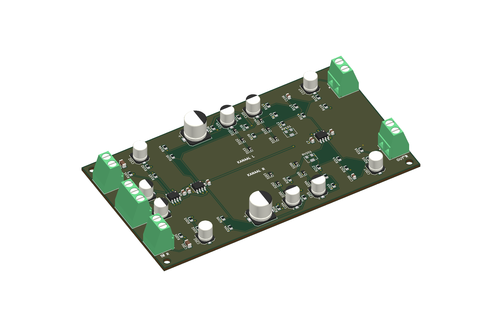

# Kant-en-klaar laten maken (SMD-versie)

Niet iedereen kan of wil solderen. Daarom is er naast de through-hole-print een
**SMD-versie**. Die is gemaakt om in één keer door een printfabrikant te laten
**maken én monteren**: je krijgt een print met alle onderdelen er al op. Er zit geen
soldeerwerk meer in. Voeding, in- en uitgangen gaan met **schroefklemmen** vast.

De schakeling en alle componentwaarden zijn precies gelijk aan de through-hole-versie.
Alleen de behuizingen van de onderdelen zijn kleiner.

> **Status:** net als de through-hole-versie is de SMD-print gesimuleerd en
> gecontroleerd (ERC/DRC zonder fouten), maar **nog nooit besteld, gemaakt of
> gemeten**. De prijsindicatie hieronder is een schatting en niet nagerekend.

| | Through-hole | SMD |
|---|---|---|
| Bedoeld voor | zelf solderen | laten monteren door de fabrikant |
| Print | 178 × 100 mm | 129 × 72 mm |
| Opamps | 3× NE5532P (DIP-8, in voet) | 3× NE5532DR (SOIC-8) |
| Diodes | 1N4148 (DO-35) | 1N4148WS (SOD-323) |
| Weerstanden | metaalfilm 1 %, 0,25 W | dikfilm 1 %, 0805 |
| Ingangscondensator | 2µ2 folie | 2µ2 keramisch X7R 50 V, 1206 |
| Trimpot | Bourns 3296W | Bourns 3224W (SMD) |
| In- en uitgangen | pinheaders | schroefklemmen |
| Bestanden | `hardware/kicad/`, `hardware/export/` | `hardware/kicad_smd/`, `hardware/export_smd/` |

## Verandert de klank door de andere onderdelen?

Nee, niet meetbaar in de simulatie, en ook niet volgens de fysica:

- **1N4148WS** is dezelfde siliciumdiode als de 1N4148, alleen in een kleiner
  huisje. De spreiding tussen diodes is al meegenomen in de
  [tolerantieanalyse](04_resultaten.md#toleranties).
- **NE5532DR** is hetzelfde IC als de NE5532P, in een SMD-behuizing.
- **Dikfilmweerstanden** geven extra ruis als er gelijkspanning over staat. Dat
  gebeurt hier alleen in de voorspanning van de diodes (RBA/RBB, ca. 13 V). Maar die
  ruis komt uit op de diodeketen, en die heeft een heel lage impedantie (ca. 55 Ω
  tegenover 9 kΩ). Daardoor wordt hij meer dan honderd keer verzwakt en valt hij weg
  tegen de ruis van de opamps. Over de weerstanden in het signaalpad zelf staat
  (bijna) geen gelijkspanning.
- **De keramische ingangscondensator (X7R)** kan vervormen als er een grote
  wisselspanning over staat. Hier staat er bijna niets over. Met 100 kΩ erachter is
  de condensator zelfs bij 20 Hz maar 3,6 kΩ, dus er staat hooguit een paar procent
  van het signaal over, en er staat geen gelijkspanning op. Wie het zeker wil weten,
  kan er een SMD-foliecondensator van 1 µF (1206/1210) voor in de plaats zetten. De
  ondergrens van het frequentiebereik zakt dan van 0,7 Hz naar 1,6 Hz, nog steeds
  ruim onder 20 Hz.

## Bestellen: stap voor stap

Hieronder staat het voor JLCPCB; bij PCBWay en andere fabrikanten met montageservice
werkt het vrijwel hetzelfde. Alle bestanden staan in `hardware/export_smd/`.

| Bestand | Wat het is |
|---|---|
| `warm_preamp_gerbers.zip` | de print zelf (koperlagen, soldeermasker, opdruk, boorgaten) |
| `jlcpcb_bom.csv` | onderdelenlijst in het formaat van de fabrikant |
| `jlcpcb_cpl.csv` | plaatsingsbestand: waar elk onderdeel staat en hoe het gedraaid is |
| `bom.csv` | dezelfde onderdelenlijst, leesbaar, per waarde gegroepeerd |

1. **Print:** upload `warm_preamp_gerbers.zip`. Kies 2 lagen, 1,6 mm FR4, 1 oz koper.
   De afmetingen (129 × 72 mm) leest de site zelf uit.
2. **Montage aanzetten** ("PCB Assembly"), alleen aan de **bovenkant**. Kies het
   aantal gemonteerde printen (er is één print nodig voor stereo).
3. **Upload `jlcpcb_bom.csv` en `jlcpcb_cpl.csv`.**
4. **Kies de onderdelen.** De kolom "LCSC Part #" is bewust leeg: de voorraad van de
   fabrikant wisselt, dus een nummer van vandaag kan over een maand op zijn. Zoek per
   regel een passend onderdeel in de onderdelenzoeker van de fabrikant. Waar je op
   let:
   - weerstanden: 0805, 1 %, de genoemde waarde (ook de E96-waarden **1k27** en
     **4k42** zijn gewoon leverbaar);
   - 22p: **C0G/NP0** (niet X7R);
   - 100n: X7R, 50 V;
   - elco's: minimaal 25 V, de genoemde maat (6,3 × 7,7 mm of 10 × 10,5 mm);
   - bipolaire elco's (22µ en 10µ): "bipolar" of "non-polar" aluminium elco;
   - trimpot: 500 Ω, Bourns 3224W of gelijkwaardig (meerslagen, 4 mm, SMD);
   - schroefklemmen: 5,08 mm steek, 2- en 3-polig. Dit zijn through-hole-onderdelen.
     Laat de fabrikant ze meemonteren (dat heet bij JLCPCB "standard PCBA"), anders
     moet je ze alsnog zelf solderen.
5. **Controleer de plaatsingsweergave.** De fabrikant laat een preview zien van alle
   onderdelen op de print. Kijk vooral naar onderdelen met een richting: **de
   opamps** (pin 1), **de diodes** (streep = kathode, zoals op de printopdruk), en
   **de elco's** (+). KiCad en de fabrikant draaien sommige behuizingen anders, dus
   een correctie van 90° of 180° in de preview is normaal. Zet die dan in de preview
   recht.
6. Bestellen. Wat het kost hangt af van aantallen en hoeveel "extended parts" er
   nodig zijn (onderdelen die niet standaard op de machine liggen). Indicatie:
   enkele tientjes tot ruim honderd euro voor een paar gemonteerde printen,
   inclusief verzending. De offerte op de site is leidend.

## Als de print binnen is

Je hebt dan nog nodig:

- een **gestabiliseerde ±15 V-voeding** (kant-en-klare module, minimaal 100 mA per
  rail). Werk je niet graag met 230 V, koop dan een complete, gesloten
  ±15 V-voeding met netsnoer;
- twee **cinch-(RCA-)kabels** waarvan je aan één kant de stekker afknipt, of
  cinch-naar-draad-adapters. Die draadjes gaan in de schroefklemmen;
- een kleine schroevendraaier.

**Aansluiten** (alles met schroefklemmen, opschriften staan op de print):

- **J1:** +15 V, GND, −15 V.
- **J2 (IN L), J3 (IN R):** pin 1 = signaal (de kern van de kabel), pin 2 = massa (de
  afscherming).
- **J4 (OUT L), J5 (OUT R):** idem, naar de eindversterker.

Zet eerst de volumeknop van de eindversterker laag, zet dan de voeding aan en draai
het volume rustig op.

## Afregelen

Niet nodig. De trimpot komt van de fabriek meestal ongeveer in de middenstand
(± 250 Ω), dicht bij de ontwerpwaarde van 280 Ω. Over het hele bereik verschuift de
trimpot de derde harmonische maar ongeveer ±3 dB, dus 30 Ω ernaast scheelt
een paar tienden van een dB. Dat is minder dan de normale spreiding tussen
onderdelen. Wie wil bijstellen, kan dat met een klein schroevendraaiertje en een
geluidskaart doen, zoals beschreven in de
[bouwhandleiding (methode 2)](05_bouwhandleiding.md#afregelen).

## Printontwerp

- KiCad 10-project: `hardware/kicad_smd/warm_preamp.kicad_pro`. Het schema is
  hetzelfde als bij de through-hole-versie; alleen de footprints verschillen.
- Indeling: hetzelfde idee als de through-hole-print. De drie opamps staan op de
  middenlijn, kanaal L erboven en kanaal R gespiegeld eronder. De ingangen zitten
  links, de uitgangen rechts.
- Alle SMD-onderdelen aan de bovenkant, massavlak op beide lagen. Signaalsporen zijn
  0,3 mm en voedingssporen 0,6 mm, ruim binnen de mogelijkheden van elke
  printfabrikant.
- Automatisch gerouteerd met Freerouting. De controles (ERC en DRC, inclusief
  vergelijking met het schema) geven **geen fouten**. Er blijven alleen
  waarschuwingen over overlappende printopdruk over. Die zijn cosmetisch: de
  fabrikant knipt die opdruk weg.
- In de 3D-renders ontbreken de twee trimpotten (RV101/RV201): KiCad heeft geen
  3D-model voor de Bourns 3224W. Je ziet daar alleen de soldeereilandjes.
